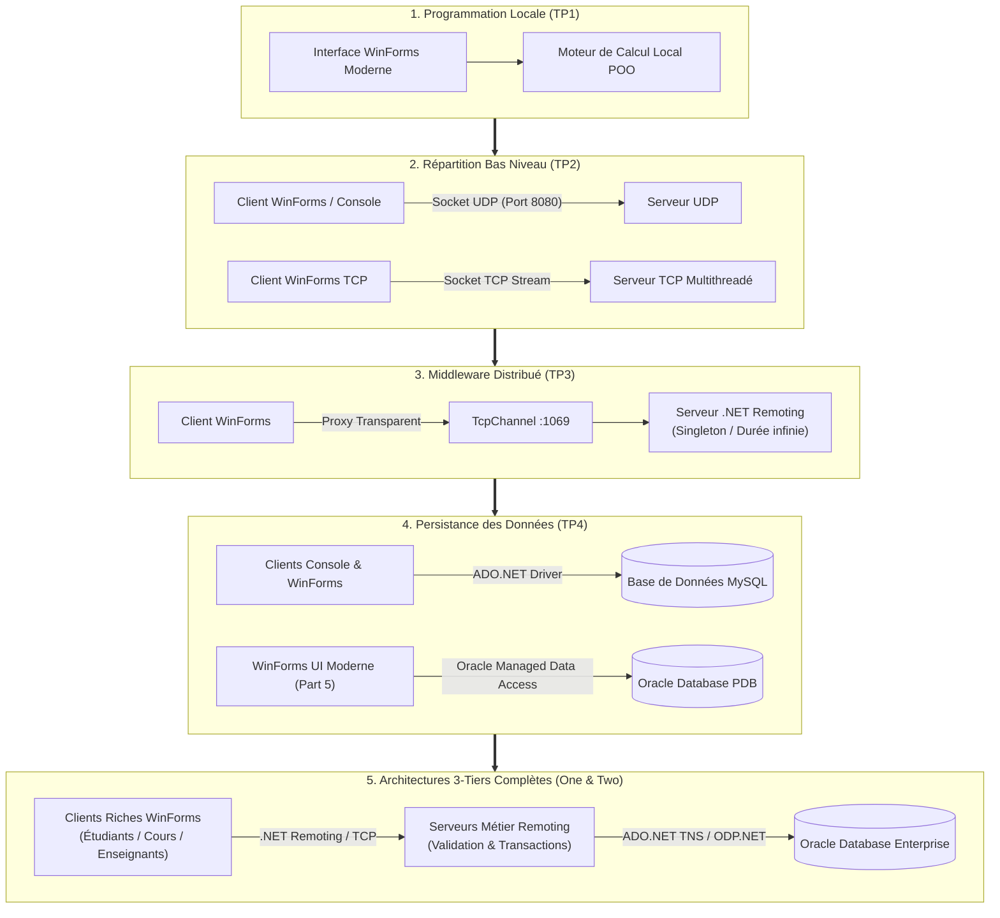
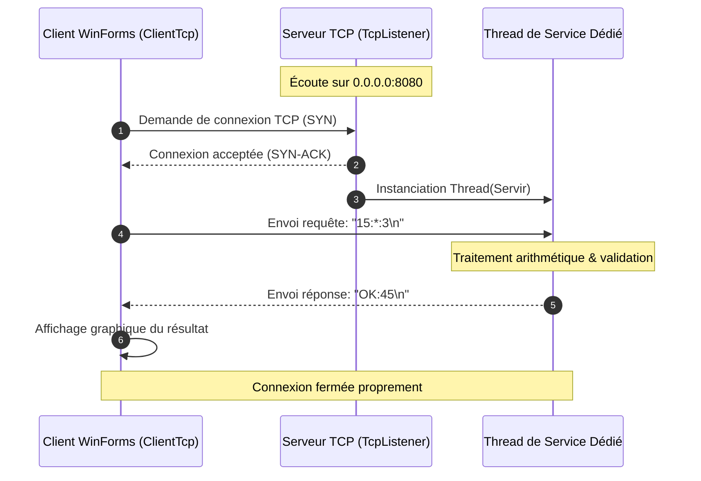
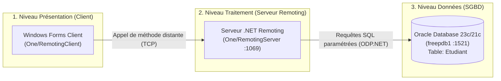
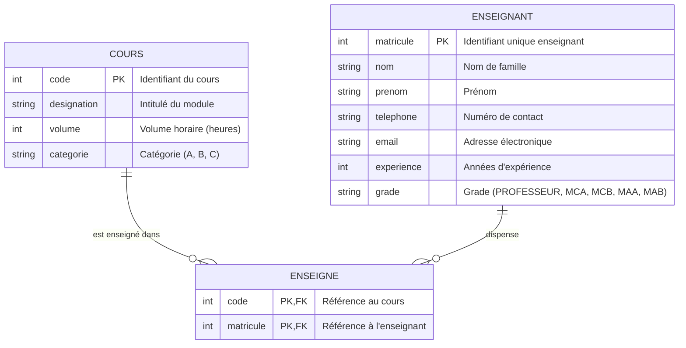
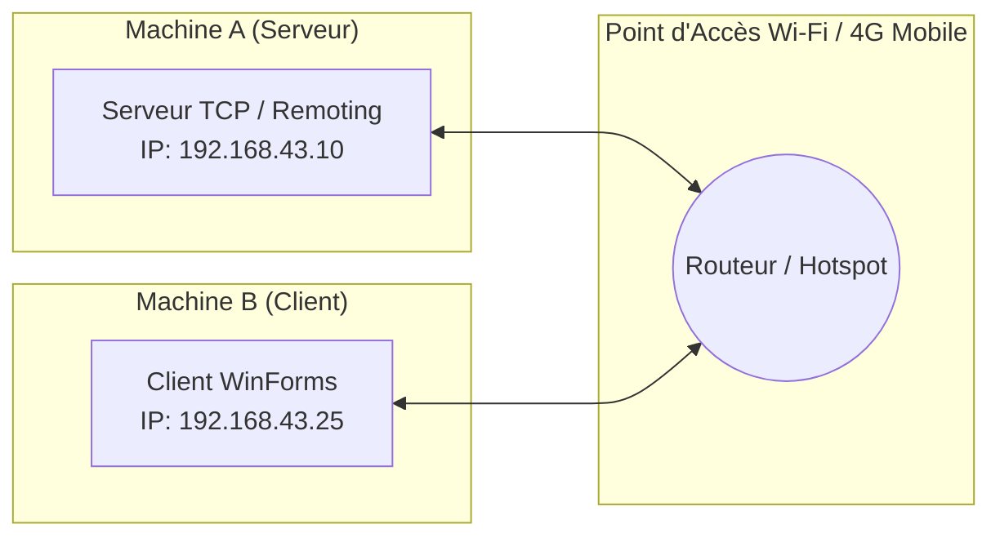

# 🌐 Construction d'Applications Réparties (CAR) — Travaux Pratiques

<p align="center">
  
  
  
  
  
  
</p>

---

### 🏛️ Contexte Académique
* **Établissement :** Université des Sciences et de la Technologie Houari Boumediene (**USTHB**)
* **Faculté :** Faculté d'Informatique & Faculté d'Électronique et d'Informatique
* **Département :** Département Informatique / Intelligence Artificielle & Systèmes Distribués (IA & SD)
* **Formation :** 2<sup>ème</sup> Année Master — **Réseaux et Systèmes Distribués (RSD)**
* **Module :** Construction d'Applications Réparties (**CAR**) — Année Universitaire 2026 / 2027

---

## 📑 Sommaire
1. [Vue d'Ensemble du Projet](#-vue-densemble-du-projet)
2. [Arborescence Détaillée du Dépôt](#-arborescence-d%C3%A9taill%C3%A9e-du-d%C3%A9p%C3%B4t)
3. [Architecture Globale & Progression](#-architecture-globale--progression)
4. [Détail des Travaux Pratiques](#-d%C3%A9tail-des-travaux-pratiques)
   - [TP1 : Programmation Orientée Objet & WinForms Moderne](#tp1--programmation-orient%C3%A9e-objet--winforms-moderne)
   - [TP2 : Sockets Réseau Bas Niveau (UDP & TCP Multithreadé)](#tp2--sockets-r%C3%A9seau-bas-niveau-udp--tcp-multithread%C3%A9)
   - [TP3 : Middleware d'Objets Distants (.NET Remoting)](#tp3--middleware-dobjets-distants-net-remoting)
   - [TP4 : Persistance & ADO.NET (MySQL & Oracle Database)](#tp4--persistance--adonet-mysql--oracle-database)
5. [Applications Réparties 3-Tiers Complètes](#-applications-r%C3%A9parties-3-tiers-compl%C3%A8tes)
   - [Projet « One » : Gestion des Étudiants (.NET Remoting + Oracle)](#projet--one---gestion-r%C3%A9partie-des-%C3%A9tudiants)
   - [Projet « Two » : Gestion Académique Cours & Enseignants](#projet--two---gestion-acad%C3%A9mique-cours--enseignants)
6. [Schémas Relationnels & Scripts SQL](#-sch%C3%A9mas-relationnels--scripts-sql)
7. [Matrice des Ports & Protocoles](#-matrice-des-ports--protocoles)
8. [Guide d'Installation & Exécution](#-guide-dinstallation--ex%C3%A9cution)
9. [Déploiement Multi-Machines (Wi-Fi / 4G)](#-d%C3%A9ploiement-multi-machines-wi-fi--4g)

---

## 🎯 Vue d'Ensemble du Projet

Ce dépôt regroupe l'ensemble des réalisations pratiques du cursus **Construction d'Applications Réparties (CAR)**. Il retrace l'évolution complète des architectures logicielles : de la conception objet locale sous interface graphique (**Windows Forms**) jusqu'au déploiement d'architectures d'entreprise **N-Tiers distribuées** intégrant :
* La communication réseau via **Sockets UDP & TCP multithreadés**.
* L'invocation de méthodes à distance via le middleware **.NET Remoting** (avec patrons de conception *Singleton* et contrats partagés).
* L'accès aux bases de données distribuées (**ADO.NET**) sous **MySQL Server** et **Oracle Database 21c/23c**.
* L'implémentation de designs modernes Windows Forms conçus dynamiquement par code (thème sombre, cartes flottantes avec ombres portées, champs à coins arrondis, gestion du High-DPI).

---

## 🗂️ Arborescence Détaillée du Dépôt

```plaintext
TP CAR/
├── One/                                # Solution 3-Tiers : Gestion des Étudiants
│   ├── RemotingClient/                 # Client lourd Windows Forms (CRUD étudiants)
│   ├── RemotingInterfaces/             # Contrat partagé (interface IRemoteOperation)
│   ├── RemotingServer/                 # Serveur .NET Remoting connecté à Oracle DB
│   └── One.slnx                        # Solution Visual Studio
├── Two/                                # Solution 3-Tiers Avancée : Cours & Enseignants
│   ├── RemotingClient/                 # Client WinForms modulaire (FormCourse & FormEns)
│   ├── RemotingInterfaces/             # Contrats multi-entités (cours, enseignants, affectations)
│   ├── RemotingServer/                 # Serveur Remoting transactionnel (Oracle DB)
│   └── Two.slnx                        # Solution Visual Studio
├── TP1/                                # TP1 : Calculatrice Windows Forms (POO en C#)
│   ├── TP1/                            # Application WinForms avec interface moderne
│   ├── TP#1-Partie2.pdf                # Énoncé officiel des travaux pratiques
│   └── TP1.slnx                        # Solution Visual Studio
├── TP2/                                # TP2 : Communication par Sockets (UDP & TCP)
│   ├── Client/                         # Client Console UDP (tests point-à-point)
│   ├── UdpServeur/                     # Serveur Console UDP (écoute port 8080)
│   ├── TcpServeur/                     # Serveur Console TCP multithreadé (1 thread par client)
│   ├── TP1/                            # Client Windows Forms connecté via Socket TCP
│   ├── TP#2---Sockets.pdf              # Énoncé officiel des travaux pratiques
│   └── TP1.slnx                        # Solution Visual Studio
├── TP3/                                # TP3 : Middleware .NET Remoting
│   ├── RemotingClient/ ou TP1/         # Client Windows Forms consommant l'objet distant
│   ├── RemotingInterfaces/             # Interface commune IRemoteOperation
│   ├── RemotingServeur/                # Serveur .NET Remoting (canal TCP, port 1069)
│   ├── TP3-Partie 1.pdf                # Énoncé officiel des travaux pratiques
│   └── TP1.slnx                        # Solution Visual Studio
├── TP4_PART1/                          # TP4 : Persistance des Données (MySQL & Oracle)
│   ├── TP4_PART1/                      # Partie 1 : Console C# connectée à MySQL (SELECT / INSERT)
│   ├── TP4_PART2/                      # Partie 2 : WinForms avec DataGridView & thème soigné
│   ├── TP4_PART3/                      # Partie 3 : Console avec saisie interactive continue
│   ├── TP4_PART4/                      # Partie 4 : WinForms CRUD complet avec recherche & filtres
│   ├── TP4_PART5/                      # Partie 5 : WinForms Haute Fidélité connecté à Oracle DB
│   └── TP4_PART1.slnx                  # Solution Visual Studio
└── README.md                           # Documentation officielle du projet
```

---

## 🏗️ Architecture Globale & Progression



---

## 🔬 Détail des Travaux Pratiques

### TP1 : Programmation Orientée Objet & WinForms Moderne

* **Fichier de référence :** [`TP#1-Partie2.pdf`](file:///c:/vrmx/TP%20CAR/TP1/TP#1-Partie2.pdf)
* **Code source principal :** [`Calculatrice.cs`](file:///c:/vrmx/TP%20CAR/TP1/TP1/Calculatrice.cs)

#### Objectifs & Réalisations
1. **Révision approfondie de la POO en C# :** encapsulation, gestion rigoureuse des états de saisie, opérateurs unaires et binaires.
2. **Interface Graphique Ergonomique :**
   - Mise en page automatique adaptative calculée par code selon la résolution (**gestion High-DPI** via `echelle = g.DpiX / 96f`).
   - Thème sombre moderne (palette `RGB 32, 32, 32` avec touches d'accentuation bleu néon).
   - Zone d'affichage multi-ligne avec historique complet des calculs (ex. `5 + 3 = 8` ou `√(9) = 3`).
3. **Fonctionnalités Implémentées :**
   - Opérations de base : `+`, `−`, `×`, `÷`.
   - Opérations scientifiques & unaires : Racine carrée (`√`), Pourcentage (`%`), Inverse (`1/x`), Inversion de signe (`±`).
   - Gestion de la mémoire standard : `MC` (Clear), `MR` (Recall), `MS` (Store), `M+` (Add), `M-` (Subtract).
   - Formatage culturel strict avec `CultureInfo("fr-FR")` pour la gestion des virgules décimales.

---

### TP2 : Sockets Réseau Bas Niveau (UDP & TCP Multithreadé)

* **Fichier de référence :** [`TP#2---Sockets.pdf`](file:///c:/vrmx/TP%20CAR/TP2/TP#2---Sockets.pdf)
* **Composants clés :**
  - Serveur TCP : [`TcpServeur/serveur.cs`](file:///c:/vrmx/TP%20CAR/TP2/TcpServeur/serveur.cs)
  - Client TCP WinForms : [`TP1/ClientTcp.cs`](file:///c:/vrmx/TP%20CAR/TP2/TP1/ClientTcp.cs)
  - Client UDP Console : [`Client/client.cs`](file:///c:/vrmx/TP%20CAR/TP2/Client/client.cs)
  - Serveur UDP Console : [`UdpServeur/serveur.cs`](file:///c:/vrmx/TP%20CAR/TP2/UdpServeur/serveur.cs)

#### 1. Communication Datagramme UDP
- Fonctionnement en mode non connecté à l'aide de paquets `UdpClient`.
- Format du protocole d'application textuel :
  $$\text{Requête} : \texttt{clientIP:clientPort:nb1:signe:nb2}$$
  $$\text{Réponse} : \texttt{nb1 signe nb2 = resultat}$$
- Ajout d'un délai d'expiration réseau (`ReceiveTimeout = 3000ms`) côté client pour éviter tout blocage indéfini si le serveur est injoignable.

#### 2. Communication Orientée Connexion TCP Multithreadée
- Mise en œuvre d'un `TcpListener` sur le port `8080`.
- **Multithreading :** Chaque connexion entrante est déléguée à un thread d'arrière-plan dédié (`Thread.IsBackground = true`), permettant de traiter plusieurs clients simultanément sans bloquer la boucle d'écoute.
- Protocole robuste basé sur flux textuel :
  $$\text{Requête} : \texttt{nb1:signe:nb2}\backslash n \quad\longrightarrow\quad \text{Réponse} : \texttt{OK:resultat}\backslash n \quad\text{ou}\quad \texttt{ERR:message}\backslash n$$



---

### TP3 : Middleware d'Objets Distants (.NET Remoting)

* **Fichier de référence :** [`TP3-Partie 1.pdf`](file:///c:/vrmx/TP%20CAR/TP3/TP3-Partie%201.pdf)
* **Composants clés :**
  - Contrat : [`RemotingInterfaces/IRemoteOperation.cs`](file:///c:/vrmx/TP%20CAR/TP3/RemotingInterfaces/IRemoteOperation.cs)
  - Serveur : [`RemotingServeur/RemoteOperation.cs`](file:///c:/vrmx/TP%20CAR/TP3/RemotingServeur/RemoteOperation.cs) & [`RemoteMain.cs`](file:///c:/vrmx/TP%20CAR/TP3/RemotingServeur/RemoteMain.cs)
  - Client WinForms : [`TP1/Calculatrice.cs`](file:///c:/vrmx/TP%20CAR/TP3/TP1/Calculatrice.cs)

#### Principes Fondamentaux Déployés
* **Séparation Contrat / Implémentation :** L'interface partagée `IRemoteOperation` est compilée dans une bibliothèque de liaisons dynamiques (`RemotingInterfaces.dll`) référencée à la fois par le client et le serveur.
* **Sémantique `MarshalByRefObject` :** L'objet distant ne traverse pas le réseau sous forme de copie sérialisée. Le client manipule un **Proxy Transparent** qui intercepte les appels de méthode et les achemine sous forme de messages RPC binaires via un canal TCP (`TcpChannel`).
* **Mode d'Activation Singleton & Bail Infini :**
  ```csharp
  // Enregistrement du service distant en mode Singleton sur le port 1069
  RemotingConfiguration.RegisterWellKnownServiceType(
      typeof(RemoteOperation), 
      "RemoteOperation", 
      WellKnownObjectMode.Singleton
  );
  
  // Dans RemoteOperation.cs : annulation de l'expiration du bail par défaut
  public override object InitializeLifetimeService() => null;
  ```
* **Client Lourd Hybride :** Les opérations élémentaires et la logique d'affichage restent exécutées localement, tandis que les calculs arithmétiques distants sont déportés sur le serveur d'applications.

---

### TP4 : Persistance & ADO.NET (MySQL & Oracle Database)

* **Emplacement du projet :** [`TP4_PART1/`](file:///c:/vrmx/TP%20CAR/TP4_PART1/)
* **Code source par partie :**
  - Console MySQL (Base) : [`TP4_PART1/Connection.cs`](file:///c:/vrmx/TP%20CAR/TP4_PART1/TP4_PART1/Connection.cs)
  - WinForms Simple : [`TP4_PART2/Form1.cs`](file:///c:/vrmx/TP%20CAR/TP4_PART1/TP4_PART2/Form1.cs)
  - Console Interactive : [`TP4_PART3/Program.cs`](file:///c:/vrmx/TP%20CAR/TP4_PART1/TP4_PART3/Program.cs)
  - WinForms CRUD & Recherche : [`TP4_PART4/Form1.cs`](file:///c:/vrmx/TP%20CAR/TP4_PART1/TP4_PART4/Form1.cs)
  - WinForms Oracle Haute Fidélité : [`TP4_PART5/Form1.cs`](file:///c:/vrmx/TP%20CAR/TP4_PART1/TP4_PART5/Form1.cs)

#### Progression des 5 Parties
1. **Partie 1 (Console MySQL) :** Connexion via `MySqlConnection`, exécution de commandes `SELECT` avec `MySqlDataAdapter` et requêtes paramétrées `INSERT` pour prévenir les injections SQL.
2. **Partie 2 (WinForms Simple) :** Présentation tabulaire via `DataGridView`, bouton d'actualisation et affichage du nombre de tuples.
3. **Partie 3 (Console Interactive) :** Boucle d'insertion continue avec validation des types de données (`int.TryParse`).
4. **Partie 4 (WinForms CRUD Avancé) :** Interface personnalisée en code C# (sans dépendance aux assistants visuels), filtrage instantané, boîte de dialogue de confirmation avant suppression.
5. **Partie 5 (WinForms Entreprise avec Oracle DB) :**
   - Utilisation du pilote officiel `Oracle.ManagedDataAccess.Client`.
   - Système de composants graphiques vectoriels développés sur mesure : `Card` (panneaux à coins arrondis et ombre portée), `RoundButton` (états survol/clic animés), `RoundedField` (mise en surbrillance au focus).
   - Filtrage temps réel multi-colonnes par `DataView.RowFilter` et gestion des codes d'erreur Oracle (`ORA-00001`, `ORA-12541`, etc.).

---

## 🏛️ Applications Réparties 3-Tiers Complètes

### Projet « One » : Gestion Répartie des Étudiants

* **Répertoire :** [`One/`](file:///c:/vrmx/TP%20CAR/One/)
* **Composants :**
  - Contrat : [`One/RemotingInterfaces/IRemoteOperation.cs`](file:///c:/vrmx/TP%20CAR/One/RemotingInterfaces/IRemoteOperation.cs)
  - Serveur : [`One/RemotingServer/RemoteOperation.cs`](file:///c:/vrmx/TP%20CAR/One/RemotingServer/RemoteOperation.cs)
  - Client : [`One/RemotingClient/Client.cs`](file:///c:/vrmx/TP%20CAR/One/RemotingClient/Client.cs)



#### Méthodes Distantes Exposées
| Méthode | Paramètres | Description |
| :--- | :--- | :--- |
| `Add` | `(int matricule, string nom, string prenom)` | Insère un étudiant avec vérification d'unicité |
| `Update` | `(int matricule, string nom, string prenom)` | Met à jour le nom et prénom d'un étudiant existant |
| `Delete` | `(int matricule)` | Supprime l'enregistrement identifié par son matricule |
| `Show` | *(aucun)* | Retourne l'ensemble de la table `Etudiant` sous forme de `DataTable` |
| `ShowStudent` | `(int matricule)` | Recherche ciblée et retourne un étudiant spécifique |

---

### Projet « Two » : Gestion Académique (Cours & Enseignants)

* **Répertoire :** [`Two/`](file:///c:/vrmx/TP%20CAR/Two/)
* **Composants :**
  - Contrat : [`Two/RemotingInterfaces/IRemoteOperation.cs`](file:///c:/vrmx/TP%20CAR/Two/RemotingInterfaces/IRemoteOperation.cs)
  - Serveur : [`Two/RemotingServer/RemoteOperation.cs`](file:///c:/vrmx/TP%20CAR/Two/RemotingServer/RemoteOperation.cs)
  - Client : [`Two/RemotingClient/FormCourse.cs`](file:///c:/vrmx/TP%20CAR/Two/RemotingClient/FormCourse.cs) & [`FormEns.cs`](file:///c:/vrmx/TP%20CAR/Two/RemotingClient/FormEns.cs)

#### Modèle Conceptuel de Données



#### Points Forts de l'Implémentation Serveur
* **Gestion Transactionnelle Atomique :** Lors de l'ajout d'un enseignant avec assignation à un cours (`AddTeacher`), le serveur initie une transaction Oracle (`con.BeginTransaction()`). Si l'une des écritures échoue, l'ensemble de l'opération subit un `Rollback()` complet pour préserver l'intégrité référentielle.
* **Génération Automatique de Clé :** Calcul de la clé primaire par `SELECT NVL(MAX(matricule), 0) + 1 FROM ENSEIGNANT`.
* **Requêtes de Jointure Avancées :** Récupération de l'équipe pédagogique d'un module par jointure relationnelle entre `ENSEIGNANT` et `ENSEIGNE`.
* **Traduction Intelligente des Erreurs :** Conversion automatique des codes d'erreur natifs Oracle (ex. `ORA-00001`, `ORA-02292`, `ORA-02291`) en messages explicites pour l'utilisateur.

---

## 💾 Schémas Relationnels & Scripts SQL

### 1. Base MySQL (`db_tp4` — Utilisée dans TP4)
```sql
CREATE DATABASE IF NOT EXISTS db_tp4 CHARACTER SET utf8mb4 COLLATE utf8mb4_unicode_ci;
USE db_tp4;

CREATE TABLE IF NOT EXISTS Etudiant (
    matricule INT PRIMARY KEY,
    nom VARCHAR(50) NOT NULL,
    prenom VARCHAR(50) NOT NULL
) ENGINE=InnoDB;

-- Données initiales de test
INSERT INTO Etudiant (matricule, nom, prenom) VALUES
(101, 'BENALI', 'Karim'),
(102, 'BOUZID', 'Amina'),
(103, 'MEZIANI', 'Sofiane');
```

### 2. Base Oracle Database (`VRMX` / `freepdb1` — Utilisée dans TP4_PART5, One & Two)
```sql
-- Création de la table Étudiant (One & TP4_PART5)
CREATE TABLE Etudiant (
    matricule NUMBER(10) PRIMARY KEY,
    nom VARCHAR2(50) NOT NULL,
    prenom VARCHAR2(50) NOT NULL
);

-- Création des tables de gestion des cours et enseignants (Two)
CREATE TABLE COURS (
    code NUMBER(5) PRIMARY KEY,
    designation VARCHAR2(50) NOT NULL,
    volume NUMBER(3) NOT NULL,
    categorie VARCHAR2(5) CHECK (categorie IN ('A', 'B', 'C'))
);

CREATE TABLE ENSEIGNANT (
    matricule NUMBER(10) PRIMARY KEY,
    nom VARCHAR2(50) NOT NULL,
    prenom VARCHAR2(50) NOT NULL,
    telephone VARCHAR2(25),
    email VARCHAR2(50),
    experience NUMBER(3),
    grade VARCHAR2(20) CHECK (grade IN ('PROFESSEUR', 'MCA', 'MCB', 'MAA', 'MAB'))
);

CREATE TABLE ENSEIGNE (
    code NUMBER(5) REFERENCES COURS(code) ON DELETE CASCADE,
    matricule NUMBER(10) REFERENCES ENSEIGNANT(matricule) ON DELETE CASCADE,
    CONSTRAINT pk_enseigne PRIMARY KEY (code, matricule)
);

COMMIT;
```

---

## 🔌 Matrice des Ports & Protocoles

| Service / Projet | Port d'Écoute | Protocole Réseau | Description |
| :--- | :---: | :---: | :--- |
| **Serveur UDP (TP2)** | `8080` | UDP / Datagramme | Calculatrice en mode non connecté |
| **Serveur TCP (TP2)** | `8080` | TCP / Stream UTF-8 | Calculatrice multithreadée distribuée |
| **Serveur .NET Remoting (TP3)** | `1069` | TCP / Binaire RPC | Middleware d'appel de méthodes à distance |
| **Serveur Remoting (One)** | `1069` | TCP / Binaire RPC | Service distant de gestion des étudiants |
| **Serveur Remoting (Two)** | `1069` | TCP / Binaire RPC | Service distant de gestion des cours et enseignants |
| **MySQL Server (TP4)** | `3306` | TCP / MySQL Native | Serveur de bases de données relationnelles |
| **Oracle Listener (TP4, One, Two)**| `1521` | TCP / TNS Listener | SGBD Oracle PDB (`freepdb1`) |

---

## 🚀 Guide d'Installation & Exécution

### Prérequis Techniques
* **Système d'exploitation :** Windows 10 ou 11 (64-bit).
* **Environnement de développement :** Visual Studio 2022 avec la charge de travail *Développement .NET Desktop*.
* **Framework cible :** .NET Framework 4.7.2.
* **SGBD :** 
  - MySQL Server 8.0+ (ou XAMPP / MariaDB).
  - Oracle Database 21c XE ou 23c Free (PDB nommée `freepdb1`).
* **Paquets NuGet requis :**
  - `Oracle.ManagedDataAccess`
  - `MySql.Data`

### Procédure de Compilation & Démarrage

> [!IMPORTANT]
> Dans toute architecture Client/Serveur ou distribuée, **démarrez impérativement le serveur avant de lancer l'application cliente**, sinon le client lèvera une exception réseau de type `SocketException` ou `RemotingException`.

1. **Cloner ou ouvrir l'espace de travail :**
   Ouvrez le dossier racine dans Visual Studio ou ouvrez directement les fichiers `.slnx` correspondants.
2. **Pour tester TP2 (Sockets TCP) :**
   - Lancez le projet `TcpServeur` (une console s'ouvre, confirmant l'écoute sur le port `8080`).
   - Lancez le projet `TP1` (client graphique) : saisissez vos calculs, le traitement est délégué au serveur.
3. **Pour tester TP3 ou Projet One / Two (.NET Remoting) :**
   - Assurez-vous que l'instance Oracle tourne sur le port `1521`.
   - Lancez le projet `RemotingServer` : la console doit afficher *"Le serveur a démarré avec succès"*.
   - Lancez le projet `RemotingClient` : l'interface se connecte automatiquement et synchronise la grille de données.

---

## 🌐 Déploiement Multi-Machines (Wi-Fi / 4G)

Pour valider le caractère réparti des applications sur deux ordinateurs physiques :



1. **Connecter les deux machines** sur le même réseau local (par exemple, le partage de connexion 4G d'un smartphone).
2. **Relever l'adresse IP de la machine Serveur :**
   Dans l'invite de commande de la machine hébergeant le serveur :
   ```cmd
   ipconfig
   ```
   Notez l'adresse IPv4 (ex. `192.168.43.10`).
3. **Configurer l'adresse dans le Client :**
   - Dans le TP2 : modifier la constante `Hote` dans [`TP1/ClientTcp.cs`](file:///c:/vrmx/TP%20CAR/TP2/TP1/ClientTcp.cs#L12) :
     ```csharp
     public const string Hote = "192.168.43.10";
     ```
   - Dans le TP3 / One / Two : remplacer `localhost` dans l'URL de connexion du client par l'adresse IP du serveur :
     ```csharp
     "tcp://192.168.43.10:1069/RemoteOperation"
     ```
4. **Ouvrir les ports sur le pare-feu Windows de la machine Serveur :**
   Exécutez dans un terminal PowerShell en mode Administrateur :
   ```powershell
   New-NetFirewallRule -DisplayName "TP CAR Sockets (8080)" -Direction Inbound -LocalPort 8080 -Protocol TCP -Action Allow
   New-NetFirewallRule -DisplayName "TP CAR Remoting (1069)" -Direction Inbound -LocalPort 1069 -Protocol TCP -Action Allow
   ```
5. **Vérifier la connectivité :**
   ```cmd
   ping 192.168.43.10
   ```

---

<p align="center">
  <b>USTHB — Master 2 Réseaux et Systèmes Distribués (RSD)</b><br/>
  Construction d'Applications Réparties • Année Universitaire 2026 / 2027
</p>
